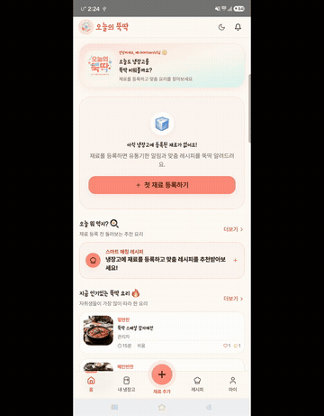
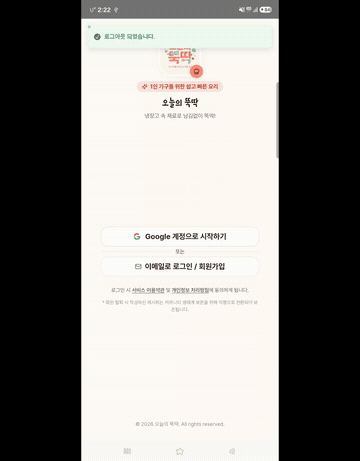
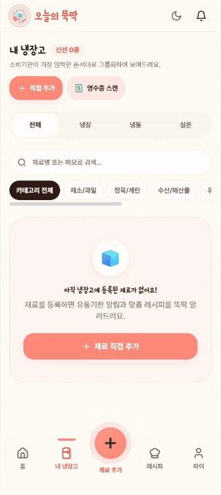
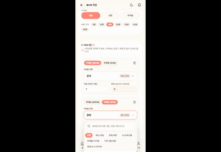
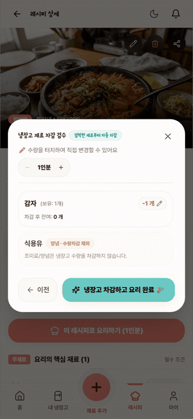
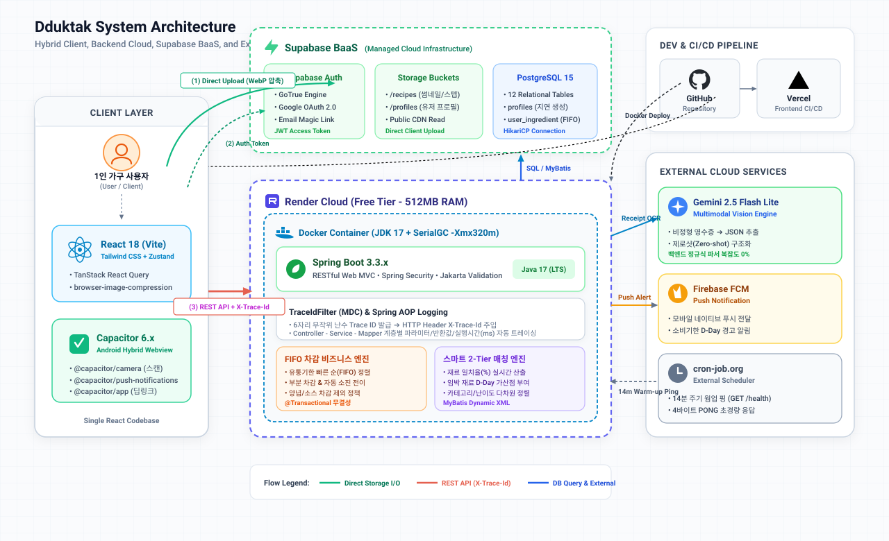

# 오늘의 뚝딱 (Dduktak)

<div align="center">


### 1인 가구를 위한 냉장고 관리 및 스마트 맞춤 요리 솔루션
**"냉장고에 뭐가 남았지?" — 잔반 최소화, 식비 절감, 선입선출(FIFO) 기반 스마트 레시피 매칭 플랫폼**

<br/>

[](https://dduktak-one.vercel.app)
[](https://dduktak-one.vercel.app/download)
[](./integration-tests/README.md)
[](./.agent/05_API_SPECIFICATION.md)

<br/>

[](https://react.dev/)
[](https://www.typescriptlang.org/)
[](https://capacitorjs.com/)
[](https://tailwindcss.com/)
[](https://spring.io/projects/spring-boot)
[](https://mybatis.org/)
[](https://www.postgresql.org/)
[](https://supabase.com/)
[](https://ai.google.dev/)

</div>

---

## 목차 (Table of Contents)
1. [서비스 소개 및 핵심 엔지니어링 지표](#서비스-소개-및-핵심-엔지니어링-지표-key-metrics)
2. [주요 기능 라이브 데모](#주요-기능-라이브-데모-live-feature-demos)
3. [시스템 아키텍처 및 기술적 의사결정](#시스템-아키텍처-및-기술적-의사결정-tech-choices)
4. [핵심 엔지니어링 트러블슈팅 TOP 4](#핵심-엔지니어링-트러블슈팅-top-4)
5. [AI 오케스트레이션 거버넌스 및 작업 로그 체계](#ai-오케스트레이션-거버넌스-및-작업-로그-체계-agent-system)
6. [3중 교차 통합 테스트 체계](#3중-교차-통합-테스트-체계-qa-summary)

---

## 서비스 소개 및 핵심 엔지니어링 지표 (Key Metrics)

**'오늘의 뚝딱'**은 1인 가구가 겪는 고질적인 문제인 **식재료 방치 및 부패, 배달음식 의존으로 인한 식비 부담**을 해결하기 위해 기획된 실시간 냉장고 관리 & 맞춤 레시피 솔루션입니다.
영수증 사진 한 장으로 식재료를 자동 등록하고, 냉장고에 보유한 재료를 기반으로 즉시 조리 가능한 최적의 레시피를 추천하며, 요리 완료 시 **선입선출(FIFO)** 알고리즘에 따라 식재료를 자동으로 차감합니다.

### 정량적 엔지니어링 성과

| 핵심 지표 | 달성 결과 | 엔지니어링 접근 방식 및 비즈니스 가치 |
| :--- | :---: | :--- |
| **백엔드 메모리 부하** | **0 MB** | **클라이언트 직접 업로드(Direct Upload)**: 고화질 이미지를 브라우저 단에서 WebP로 압축 후 Supabase Storage로 직행시켜, Render Free Tier(512MB RAM) 환경에서 대용량 바이너리 I/O 부하 및 OOM(Out Of Memory)을 원천 차단 |
| **영수증 파싱 생산성** | **80% 단축** | **Gemini Flash Lite 제로샷 추출**: 마트별 비정형 영수증을 복잡한 백엔드 정규식 파서 없이 `이미지 ➔ 정형 JSON`으로 다이렉트 변환하여 개발 공수 절감 및 유지보수성 극대화 |
| **전 계층 추적성 (Observability)** | **100% 확보** | **AOP & MDC Trace ID 연동**: 요청 진입 서블릿 필터부터 Controller, Service, Mapper 전 계층에 6자리 Trace ID(`X-Trace-Id`)를 주입하여 병목 구간 및 클라이언트 에러를 단번에 식별 |
| **에러 핸들링 결합도** | **0% (완전 자동화)** | **UX 태그 기반 풀스택 에러 파이프라인**: `[도메인]_[UX태그]_[상세원인]` 규격으로 백엔드 예외를 정의하고 프론트엔드가 이를 자동 분기(폼 인라인 vs Sonner 토스트) 처리하여 프론트-백 간 하드코딩 의존성을 원천 제거 |
| **E2E 비즈니스 무결점** | **20/20 PASS (100%)** | **3중 교차 통합 테스트**: 20개 핵심 시나리오에 대해 시각 증적(GIF), 서버 AOP 트레이스, DB 전/후 스냅샷의 3중 교차 검증을 완료하여 결함률 0% 달성 |

---

## 주요 기능 라이브 데모 (Live Feature Demos)

| 1. 안드로이드 물리 뒤로가기 모달 계층 제어 | 2. 구글 소셜 로그인 딥링크 복귀 & 401 방어 |
| :---: | :---: |
|  |  |
| **LIFO CloseStack & 이중 방어**<br/>모달/바텀시트 오픈 시 뒤로가기 키 입력으로 최상단 모달만 우선 닫히며, 홈 화면 이중 입력 시 안전 종료 | **딥링크 복귀 시 세션 동기화**<br/>구글 OAuth 인앱 브라우저에서 복귀 시 세션 복구 전 불필요한 401 만료 토스트 차단 및 자동 로그인 |
| **3. FCM 네이티브 백그라운드 푸시 & 딥링크** | **4. 영수증 OCR 스캔 & 글자 안 잘리는 검수 모달** |
|  |  |
| **Heads-up 시스템 알림 & 스마트 라우팅**<br/>소비기한 임박 알림 팝업 터치 시 백엔드 페이로드(`route`)를 파싱하여 해당 화면으로 직행 | **Gemini AI 제로샷 추출 & UI 사용성**<br/>영수증 분석 후 날짜/수량 자동 매핑 및 모바일 뷰포트에서도 소비기한 날짜가 잘리지 않게 표출 |
| **5. 스마트 매칭 추천 피드 & 점수 100% 일치** | **6. 3-Way 요리완료 & FIFO 선입선출 자동 차감** |
|  |  |
| **실시간 2-Tier 매칭률 산출**<br/>내 냉장고 보유 재료 기반 매칭률 계산 및 리스트-상세 페이지 간 점수 오차 0% 완벽 동기화 | **트랜잭션 무결성 기반 FIFO 차감**<br/>유통기한 빠른 주재료부터 자동 소진되며 양념/조미료류는 차감 대상에서 원천 배제 |

---

## 시스템 아키텍처 및 기술적 의사결정 (Tech Choices)

### 시스템 아키텍처 다이어그램 (System Architecture)



---

### 기술 선택 이유 및 의사결정 (Technical Decision Making)

#### 1. 하이브리드 앱(Capacitor 6.x) 채택 이유
> "레시피 플랫폼은 외부 검색 유입과 링크 공유를 통한 바이럴이 생명입니다. 네이티브 전용 앱은 웹 검색 유저에게 앱 설치 장벽을 만들지만, **웹뷰 하이브리드 구조(Capacitor)**를 채택함으로써 **단일 React 코드베이스로 웹 SEO/공유 접근성과 모바일 전용 네이티브 푸시/제스처 경험을 동시에 확보**했습니다."

#### 2. Spring Boot 3.x + MyBatis 채택 & 인프라 최적화
> "식재료 선입선출(FIFO) 차감, 2-Tier 매칭 가산점 등 트랜잭션 무결성과 복잡한 도메인 비즈니스 로직을 다루기 위해 **엔터프라이즈급 안정성을 지닌 Spring Boot**를 선택했습니다. 무료 인프라의 콜드 스타트와 메모리 부하는 **클라이언트 다이렉트 업로드로 백엔드 I/O를 덜어내고, 무음 핑(Silent Ping) 웜업 인터랙션을 프론트에 구축**해 해결했습니다."

#### 3. Gemini 2.5 Flash Lite Vision 채택 이유
> "상용 OCR API는 텍스트 위치만 추출해 줄 뿐, 규격이 제각각인 마트 영수증에서 '식품 품목명'만 정제하려면 백엔드에 방대한 정규식 파서가 필요합니다. 반면 멀티모달 LLM(Gemini Flash Lite)을 활용해 **'비정형 영수증 이미지 ➔ 표준 JSON 배열'로 제로샷 구조화 추출을 수행함으로써 파이프라인 복잡도와 운영 비용을 동시에** 잡았습니다."

#### 4. Supabase BaaS 이원화 (Auth / DB / Storage)
> "백엔드가 OAuth 토큰 교환, OTP 메일링, 파일 바이너리 I/O까지 떠안으면 단일 장애점(SPOF)이 되고 서버 리소스 낭비가 심해집니다. 따라서 **인증과 스토리지는 Supabase 클라우드 인프라로 오프로딩하고, 백엔드는 순수 도메인 비즈니스 API에만 집중**시켜 오히려 전체 시스템의 결합도를 낮추고 생산성을 극대화했습니다."

---

## 핵심 엔지니어링 트러블슈팅 TOP 4

### 1. [BaaS / Auth] `/api/v1/auth/init` 지연 프로필 생성 및 세션 동기화 원자성 확보
* **문제 상황**: Supabase Auth 가입 완료 직후 클라이언트가 백엔드 API를 호출할 때, 백엔드 DB의 `profiles` 테이블에 해당 유저 레코드가 존재하지 않아 외래키(FK) 참조 에러 및 레이스 컨디션 발생.
* **원인 분석**: OAuth 소셜 로그인 및 이메일 매직링크 가입 경로가 다양하여, Supabase Auth 계정 생성 이벤트와 백엔드 비즈니스 프로필(닉네임, 유저태그, 알림 설정 등) 생성 타이밍이 완벽히 동기화되지 않음.
* **해결 방안 (`AUTH-01-2`)**:
  - 인증 성공 후 최초 진입 시 무조건 `POST /api/v1/auth/init` 엔드포인트를 호출하는 **지연 프로필 초기화(Lazy Initialization)** 메커니즘 구축.
  - MyBatis의 `ON CONFLICT (id) DO NOTHING` 업서트(Upsert) 쿼리를 적용하여, 중복 호출이나 동시성 경합 시에도 멱등성(Idempotency)을 100% 보장하도록 처리.

```sql
-- profiles 원자적 지연 생성 쿼리
INSERT INTO profiles (id, email, nickname, user_tag, profile_image, role, created_at)
VALUES (#{id}, #{email}, #{nickname}, #{userTag}, #{profileImage}, 'USER', NOW())
ON CONFLICT (id) DO NOTHING;
```

---

### 2. [Cloud Infra] Render Free Tier 512MB RAM 제약 극복 (Direct Upload & JVM SerialGC)
* **문제 상황**: 모바일 고화질 이미지(5~10MB)를 백엔드 멀티파트 폼(`MultipartFile`)으로 수신하여 가공하는 과정에서 메모리 급증으로 인해 Render 컨테이너가 강제 재부팅(`OutOfMemory: Java heap space` / SIGKILL)되는 현상 발생.
* **원인 분석**: 512MB라는 극단적인 메모리 제약 환경에서 JVM 기본 힙 메모리와 웹 서버 스레드 풀, 대용량 파일 버퍼링이 겹치며 메모리 임계치를 초과.
* **해결 방안**:
  1. **Direct Upload 아키텍처 전환**: 이미지를 백엔드를 거치지 않고 프론트엔드(`browser-image-compression`)에서 1080px WebP(1MB 이하)로 압축한 후, Supabase Storage로 직행 업로드하고 백엔드는 순수 이미지 URL 문자열만 수신.
  2. **JVM 가비지 컬렉터 튜닝**: 단일 코어 환경에 최적화된 직렬 GC(`-XX:+UseSerialGC`) 및 최대 힙 크기 제한(`-Xmx320m -Xms128m`)을 적용하여 런타임 메모리 사용량을 250~300MB 수준으로 완전히 통제.

---

### 3. [Backend Batch] 외부 스케줄러 4바이트 초경량 핑 및 소비기한 알림 쿼리 교정
* **문제 상황**: 무료 호스팅 특성상 15분간 요청이 없으면 서버가 비활성화(Sleep)되어 정기 소비기한 알림 배치 스케줄러(`@Scheduled`)가 실행되지 못하거나, 이미 다 먹은 식재료(`CONSUMED`)에 대해서도 임박 알림이 발송되는 결함 발견.
* **원인 분석**: 인스턴스 콜드 스타트 주기 문제와 함께, MyBatis 소비기한 임박 재료 조회 SQL에서 상태값 조건(`status = 'ACTIVE'`)이 누락되어 과거 이력 데이터까지 함께 조회됨.
* **해결 방안**:
  - 외부 모니터링 핑 서비스(cron-job.org)를 연동하여 14분마다 `/api/v1/health`로 4바이트(`PONG`) 초경량 핑을 전송, 인스턴스 웜업 상태를 지속 유지.
  - 소비기한 배치 쿼리에 `WHERE status = 'ACTIVE' AND expire_date <= CURRENT_DATE + INTERVAL '3 days'` 조건을 명시하여 정확한 활성 재료에 대해서만 알림이 생성되도록 정밀 교정.

---

### 4. [Observability & Error Governance] Spring AOP & MDC 기반 전역 Trace ID 로깅 및 UX 태그 에러 추적 시스템 구축
* **문제 상황**: 복잡한 비즈니스 로직(선입선출 차감, 매칭률 가산점 연산 등) 수행 중 병목이 발생하거나 사용자 화면에서 예외가 발생했을 때, 프론트엔드 콘솔 에러와 백엔드 수백 줄의 서버 로그를 상호 매핑하기 어렵고 화면별 예외 UI가 파편화되는 문제 발생.
* **해결 방안**:
  1. **MDC & Servlet Filter (`TraceIdFilter`)**: HTTP 요청 진입 즉시 6자리 고유 난수 `TraceID`를 발급하여 MDC(Mapped Diagnostic Context)에 바인딩하고, HTTP 응답 헤더 `X-Trace-Id`로 반환.
  2. **Spring AOP 메서드 추적 (`LoggingAspect`)**: Controller ➔ Service ➔ Mapper 전 계층에 걸쳐 진입 파라미터(Args)와 반환값(Return), 실행 시간(Execution Time ms)을 규격화된 포맷으로 자동 콘솔 기록.
  3. **UX 태그 기반 프론트엔드 에러 자동 분기 & 추적 연동**:
     - 백엔드는 `[도메인]_[UX태그]_[상세원인]` (예: `USER_FIELD_DUPLICATE_NICKNAME`, `INV_WARN_INSUFFICIENT_STOCK`, `SYS_ERROR_INTERNAL`) 규격을 준수.
     - React Axios 전역 인터셉터에서 에러 코드를 파싱하여, `_FIELD_`는 `react-hook-form` 입력 필드 하단에 인라인 바인딩하고, `_INFO_` / `_WARN_` / `_ERROR_`는 Sonner Toast의 색상 및 테마를 자동으로 분기 노출.
     - 특히 `_ERROR_` 발생 시 응답 헤더의 `X-Trace-Id`를 토스트 및 콘솔에 함께 표출하여, 클라이언트 화면에서 발생한 오류를 백엔드 서버 로그와 단 1초 만에 1:1 매핑하도록 구축.

```text
[AOP 로깅 콘솔 포맷 예시]
[START] [ReqID: a7f2c1] [Controller] RecipeController.cookRecipe() - Args: [recipeId=12, servings=1]
[START] [ReqID: a7f2c1] [Service] InventoryService.deductFifo() - Args: [userId=usr_01, recipeId=12]
[START] [ReqID: a7f2c1] [Mapper] InventoryMapper.selectFifoCandidates()
[END]   [ReqID: a7f2c1] [Mapper] InventoryMapper.selectFifoCandidates() - Return: 3 rows (Execution Time: 11ms)
[END]   [ReqID: a7f2c1] [Service] InventoryService.deductFifo() - Return: DeductResultDto(...) (Execution Time: 24ms)
[END]   [ReqID: a7f2c1] [Controller] RecipeController.cookRecipe() - Return: ApiResponseDto(...) (Execution Time: 35ms)
```

---

## AI 오케스트레이션 거버넌스 및 작업 로그 체계 (.agent System)

본 프로젝트는 AI 코딩 에이전트(Antigravity Core)와 개발자가 정밀하게 협업하여 구축되었습니다. AI의 환각(Hallucination)을 제어하고 대규모 코드베이스의 아키텍처 일관성을 유지하기 위해 **`.agent/` 명세 주도 거버넌스 시스템**을 도입했습니다.

```
dduktak/
├── .agent/                           # AI 오케스트레이션 거버넌스 패키지
│   ├── 00_SYSTEM_PROMPT.md           # 시스템 페르소나 및 코딩 가이드라인
│   ├── 01_TECH_STACK_AND_LIBS.md     # 승인된 라이브러리 및 기술 스택 통제 규칙
│   ├── 02_ARCHITECTURE_AND_CONVENTIONS.md # 모노레포 구조, AOP 로깅, 코딩 컨벤션
│   ├── 03_REQUIREMENTS_SUMMARY.md    # 4대 핵심 비즈니스 불변 규칙
│   ├── 04_DATABASE_SCHEMA.md         # PostgreSQL DDL 및 정규화 스키마
│   ├── 05_API_SPECIFICATION.md       # 31개 REST 엔드포인트 명세
│   ├── 06_UI_UX_GUIDELINES.md        # 디자인 시스템, Tailwind, 인터랙션 가이드
│   ├── 07_TEST_SCENARIOS.md          # 20개 인수 테스트 시나리오
│   ├── module_01~05_*.md             # 도메인별 세부 비즈니스 로직 규격서
│   └── logs/                         # 형상 추적 및 컨텍스트 유지를 위한 일일 작업 로그
│       └── YYYY-MM-DD.md             # 일일 목표, 변경 파일, 디버깅 내역 기록
```

### 작업 로그(`.agent/logs/`)가 AI 개발에 기여하는 핵심 가치

AI 에이전트와 대규모 프로젝트를 진행할 때 가장 큰 문제는 **세션 단절로 인한 컨텍스트 휘발(Context Drift)**과 **반복적인 과거 시행착오의 재발**입니다. 본 프로젝트의 `.agent/logs/`는 단순한 개발 기록을 넘어 AI 에이전트의 실시간 가드레일 역할을 수행합니다:

1. **세션 간 완벽한 컨텍스트 연속성 보장**:
   - 세션이 새로 열리더라도 에이전트가 `.agent/logs/YYYY-MM-DD.md`를 우선 탐색함으로써, 직전 작업의 기술적 의사결정 맥락(환경변수 네이밍, 특정 API 응답 형태, 포트 설정 등)을 즉시 복원하여 단절 없는 페어 프로그래밍을 지속합니다.
2. **반복 시행착오 및 코드 회귀(Regression) 원천 차단**:
   - 과거에 이미 겪고 해결한 트러블슈팅(예: Render 512MB OOM 방어 옵션, 안드로이드 백버튼 dismiss 방지, DB 식재료 상태값 `ACTIVE` 등)의 원인과 조치 내역을 로그에서 바로 확인하므로, 에이전트가 동일한 버그를 재유발하거나 이미 고쳐진 코드를 덮어쓰는 실수를 방지합니다.
3. **불필요한 대화 핑퐁 감소와 자율성 극대화**:
   - 현재 구현 진행 단계와 다음 목표가 로그에 명문화되어 있어, 사용자가 매번 프로젝트 상태를 장황하게 설명하지 않아도 에이전트가 스스로 다음 작업을 정확히 인지하고 높은 자율성으로 작업을 완수합니다.

---

## 3중 교차 통합 테스트 체계 (QA Summary)

'오늘의 뚝딱'은 단순 단위 테스트에 그치지 않고, 사용자 관점의 실제 시나리오를 검증하기 위해 **[시각 증적(Visual Evidence) + 백엔드 AOP TraceID + DB 전/후 스냅샷]**을 교차 대조하는 3중 검증 체계를 운영합니다.

> 상세 테스트 시나리오 및 증적 리포트: [`integration-tests/README.md`](./integration-tests/README.md) 참조

```
             ┌──────────────────────────────────────────────┐
             │  3-Way Cross Integration Verification (QA)   │
             └──────────────────────┬───────────────────────┘
                                    │
         ┌──────────────────────────┼──────────────────────────┐
         ▼                          ▼                          ▼
[ 1. Visual Evidence ]     [ 2. Server Trace ]       [ 3. DB Integrity ]
- E2E 비디오 녹화 (WebM)    - AOP Execution Log       - 트랜잭션 전/후 레코드 비교
- 무한 루프 GIF 대시보드    - ReqID(Trace ID) 추적    - FIFO 재료 차감 수량 확인
- 터치/반응형 UI 검증       - REST Status 200/201     - Soft Delete/ACTIVE 검증
```

* **검증 결과**: 2차 E2E 통합 테스트 20개 시나리오 **100% 무결점 PASS** (Cycle 1 결함 3건 완전 해결 및 회귀 검증 완료).

---

<div align="center">

**오늘의 뚝딱 (Dduktak) — 잔반 없는 깨끗한 냉장고, 건강한 1인 식생활의 시작**

Copyright © 2026 Dduktak Team. All Rights Reserved.

</div>
