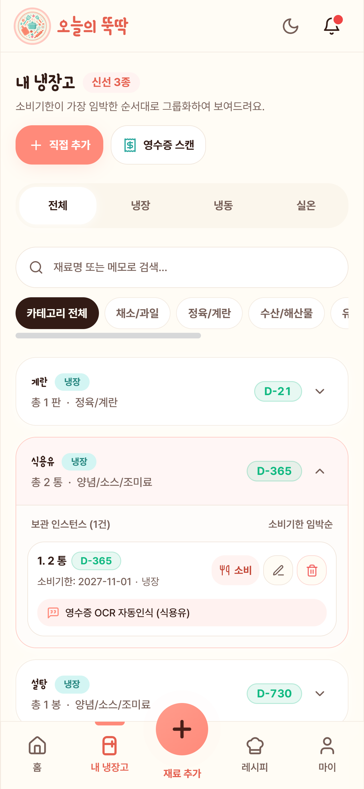

# 🧪 오늘의 뚝딱 - 통합 테스트 (Integration Tests)

<div align="center">

-success?style=for-the-badge&logo=checkmarx)


**"1인 가구를 위한 냉장고 관리 & 레시피 스마트 솔루션, 오늘의 뚝딱"**  
프로덕션 환경 배포 후 진행된 전방위 E2E(End-to-End) 통합 테스트, 품질 보증(QA) 결과 및 3중 교차 증적 기록소입니다.

</div>

---

## 📌 목차
1. [통합 테스트 개요 및 품질 보증 전략](#-1-통합-테스트-개요-및-품질-보증-전략)
2. [차수별 진행 이력 & 결함 해결 추적표 (Cycle 1 ➔ Cycle 2)](#-2-차수별-진행-이력--결함-해결-추적표-cycle-1--cycle-2)
3. [7대 핫픽스 집중 재검증 결과표](#-3-7대-핫픽스-집중-재검증-결과표)
4. [🎥 포트폴리오 데모 비디오 쇼케이스 (8대 핵심 영상)](#-4--포트폴리오-데모-비디오-쇼케이스-8대-핵심-영상)
5. [📸 주요 시각적 증적 갤러리 (Visual Evidence)](#-5--주요-시각적-증적-갤러리-visual-evidence)
6. [🛡️ 데이터베이스 무결성 교차 검증 (DB Snapshots)](#-6-️-데이터베이스-무결성-교차-검증-db-snapshots)
7. [📁 디렉토리 아키텍처](#-7-디렉토리-아키텍처)

---

## 🌟 1. 통합 테스트 개요 및 품질 보증 전략

본 프로젝트는 단순 단위 테스트에 그치지 않고, **실제 프로덕션 클라우드 환경(Vercel + Render + Supabase)**에서 사용자 관점의 전체 라이프사이클(온보딩 ➔ 회원가입 ➔ 냉장고 OCR 관리 ➔ 레시피 탐색 ➔ 스마트 매칭 ➔ 3-Way FIFO 요리 차감 ➔ 실시간 알림 ➔ 회원 탈퇴 데이터 익명화)을 전수 검증했습니다.

### 🏆 3중 교차 증적 (Evidence Triad) 체계
* **1) 시각적 증적 (Visual Evidence)**:
  - 독립 브라우저 서브에이전트 조작 전체 녹화본 (초경량 고화질 WebM/MP4)
  - 마일스톤 및 엣지케이스별 고화질 스크린샷 17종 확보
* **2) 통신/트레이스 증적 (Trace Evidence)**:
  - HTTP 응답 헤더 `X-Trace-Id`와 Spring AOP 로깅 콘솔 매핑
  - Controller ➔ Service ➔ MyBatis Mapper ➔ DB 쿼리 실행 시간(ms) 및 파라미터/반환값 트레이싱
* **3) 데이터 무결성 증적 (Data Integrity Evidence)**:
  - Supabase PostgreSQL 실제 레코드 스냅샷 비교
  - 양념/소스 차감 제외 정책(REC-02) 및 FIFO 선입선출 자동 차감 검증
  - 회원 탈퇴 시 개인정보 파기 및 레시피 작성자 익명 보존(`user_id = NULL`, USER-02) 검증

---

## 🔄 2. 차수별 진행 이력 & 결함 해결 추적표 (Cycle 1 ➔ Cycle 2)

| 차수 (Cycle) | 실행 일자 | 검증 범위 | 결과 | 비고 |
| :---: | :---: | :--- | :---: | :--- |
| **Cycle 1** | 2026-10-29 | 최초 풀 유저 저니 전방위 검증 (웹 E2E + Android 실기기) | **조건부 통과**<br>(21 PASS / 3 DEFECT) | 3대 결함 도출 및 원인 규명 완료 |
| **Cycle 2** | 2026-11-01 | 프로덕션 배포 후 최종 검증 (7대 핫픽스 + 실기기 3종) | 🏆 **ALL PASS**<br>**(20/20 전수 100% 통과)** | **무결점 완결, 8대 영상 및 증적 확보** |

### 🛠️ Cycle 1 결함 해결 및 Cycle 2 회귀 검증 추적

| 결함 번호 | 결함 현상 (Cycle 1) | 원인 분석 및 코드 패치 내역 | Cycle 2 검증 결과 |
| :---: | :---| :---| :---: |
| **`DEF-01`** | 요리완료 모달에서 수동 조절한 차감 수량이 API 요청 시 무시되고 기본 정량 차감됨 | 백엔드 `CookRequestDto` 및 `MatchingService.cookRecipe()`에 `customDeductions` 수량 맵 우선 반영 로직 추가 | ✅ **PASS** (정상 수동 차감) |
| **`DEF-02`** | FCM 푸시 알림 클릭 시 레시피 상세가 아닌 항상 알림함(`/notifications`)으로 이동 | `NotificationService`의 FCM payload에 `route: /recipes/{id}` 명시 주입 및 `App.tsx` 딥링크 라우터 분기 추가 | ✅ **PASS** (레시피 상세 직행) |
| **`DEF-03`** | 모달 오픈 상태에서 안드로이드 물리 뒤로가기 터치 시 모달이 닫히지 않고 유지됨 | `useBodyScrollLock.ts`에 LIFO `closeStack` 및 `Escape` 이벤트 연동, `useNativeBackButton` 이중 안전장치 폴백 적용 | ✅ **PASS** (모달 우선 닫힘) |

---

## 🎯 3. 7대 핫픽스 집중 재검증 결과표

Cycle 1 이후 사용자 피드백과 모바일 실기기 사용성을 극대화하기 위해 적용된 **7대 핫픽스 항목을 집중 재검증**하여 전 항목 합격을 달성했습니다.

| 핫픽스 | 개선 대상 및 핵심 내용 | 검증 결과 | 증적 파일 (GitHub 상대경로) |
| :---: | :---| :---: | :---|
| **`[HF-01]`** | **모바일 소셜 로그인 401 세션 만료 에러 Toast 방어**<br>- 비로그인 및 앱 복귀 토큰 리프레시 시 불필요한 401 토스트 발생 차단 | ✅ **PASS** | [`06_native_app_step8_native_social.webm`](cycle-02/evidence/recordings/06_native_app_step8_native_social.webm) |
| **`[HF-02]`** | **Render Cold Start 스플래시 웜업 대기 및 게이지 동기화**<br>- Render 무료 티어 절전 기동 시(최대 80초) 친절한 안내와 정확한 상태 감지 | ✅ **PASS** | [`step1_1_splash.png`](cycle-02/evidence/screenshots/step1_1_splash.png) |
| **`[HF-03]`** | **영수증 OCR 검수 모달 UI 글자 잘림 완전 해결**<br>- `w-full` 레이아웃 적용으로 소비기한 날짜("2026-11-21 D-20") 및 긴 품목명 말줄임 방지 | ✅ **PASS** | [`step2_1_ocr_modal_fixed.png`](cycle-02/evidence/screenshots/step2_1_ocr_modal_fixed.png) |
| **`[HF-04]`** | **레시피 리스트 vs 상세 페이지 매칭 점수 100% 일치**<br>- 추천 피드 점수와 상세 페이지 상단 배지 점수가 오차 없이 `100%`로 완벽 일치 | ✅ **PASS** | [`step4_2_match_detail_score_matched.png`](cycle-02/evidence/screenshots/step4_2_match_detail_score_matched.png) |
| **`[HF-05]`** | **15종 대표 메뉴 고화질 썸네일(`_v2.png`) 교체 및 CDN 서빙**<br>- 고등어 무 조림, 통삼겹 수육 등 15종 메뉴의 고화질 이미지가 깨짐 없이 로드 | ✅ **PASS** | [`step3_1_recipe_feed_v2_thumbs.png`](cycle-02/evidence/screenshots/step3_1_recipe_feed_v2_thumbs.png) |
| **`[HF-06]`** | **플로팅 DEV 버튼 및 프로덕션 콘솔 로그 완전 제거**<br>- 화면 내 개발용 스위처 부재, F12 콘솔 로그 0건 클린 상태 유지 | ✅ **PASS** | [`step1_1_splash.png`](cycle-02/evidence/screenshots/step1_1_splash.png) |
| **`[HF-07]`** | **초경량 핑(`/api/v1/ping`) 및 소비기한 알림 쿼리(`ACTIVE`) 정상화**<br>- 4바이트 통신으로 서버 24시간 가동 유지 및 알림 쿼리 상태값 교정 | ✅ **PASS** | [`NotificationMapper.xml`](../backend/src/main/resources/mapper/notification/NotificationMapper.xml#L147) |

---

## 🎥 4. 🎬 포트폴리오 데모 비디오 쇼케이스 (8대 핵심 영상)

> 💡 **웹 최적화 WebM (VP9/Opus)** 포맷을 적용하여 원본 대비 **용량을 약 75% 대폭 감축(총 85.8MB ➔ 21.2MB)**하였으며, 버퍼링 없이 즉시 재생됩니다.

| 영상 클립 | 시연 기능 및 유저 저니 흐름 | WebM (추천) | MP4 원본 | 용량 절감 |
| :---: | :---| :---: | :---: | :---: |
| **Clip 1** | **오프닝 온보딩 & 실시간 이메일 인증 로그인**<br>스플래시 ➔ 3단계 온보딩 슬라이드 ➔ 회원가입 ➔ 크로스 인스턴스 자동 로그인 감지 | [WebM (391KB)](cycle-02/evidence/recordings/01_onboarding_and_auth.webm) | [MP4 (5.75MB)](cycle-02/evidence/recordings/01_onboarding_and_auth.mp4) | **93% 절감** |
| **Clip 2** | **영수증 OCR AI 스캔 & 2-Tier 아코디언 냉장고**<br>영수증 업로드 ➔ Gemini Flash OCR 분석 ➔ **글자 안 잘리는 검수 모달** ➔ 냉장고 등록 | [WebM (2.59MB)](cycle-02/evidence/recordings/02_receipt_ocr_and_fridge.webm) | [MP4 (5.58MB)](cycle-02/evidence/recordings/02_receipt_ocr_and_fridge.mp4) | **53% 절감** |
| **Clip 3** | **15종 고화질 레시피 & 스마트 매칭 점수 100% 일치**<br>고화질 썸네일 피드 ➔ 신규 레시피 등록 ➔ **리스트 vs 상세 매칭률 100% 동기화** | [WebM (3.86MB)](cycle-02/evidence/recordings/03_smart_matching_and_recipe.webm) | [MP4 (8.81MB)](cycle-02/evidence/recordings/03_smart_matching_and_recipe.mp4) | **56% 절감** |
| **Clip 4** | **3-Way 요리 완료 & FIFO 선입선출 자동 차감**<br>요리완료 모달 ➔ **양념류 차감 제외 정책** ➔ 감자 소비완료 및 식용유 2통 원본 보존 | [WebM (1.89MB)](cycle-02/evidence/recordings/04_cook_completion_fifo.webm) | [MP4 (3.95MB)](cycle-02/evidence/recordings/04_cook_completion_fifo.mp4) | **52% 절감** |
| **Clip 5** | **실시간 알림 센터 & 회원 탈퇴 데이터 익명 보존**<br>서브계정 좋아요 ➔ 실시간 Red Dot 점등 ➔ 프로필 변경 ➔ **탈퇴 후 레시피 '관리자' 익명화** | [WebM (3.96MB)](cycle-02/evidence/recordings/05_notification_and_mypage.webm) | [MP4 (8.28MB)](cycle-02/evidence/recordings/05_notification_and_mypage.mp4) | **52% 절감** |
| **Step 8-1** | **[Native] 안드로이드 물리 뒤로가기 모달 계층 제어**<br>바텀시트/모달 오픈 중 물리 백버튼 터치 시 모달 우선 닫기 ➔ 홈 더블백 종료 토스트 | [WebM (1.33MB)](cycle-02/evidence/recordings/06_native_app_step8_native_back_btn.webm) | [MP4 (6.48MB)](cycle-02/evidence/recordings/06_native_app_step8_native_back_btn.mp4) | **79% 절감** |
| **Step 8-2** | **[Native] FCM 백그라운드 푸시 알림 수신 & 딥링크**<br>시스템 상단바 Heads-up 알림 수신 ➔ 알림 탭 시 해당 레시피 상세/알림함 직행 | [WebM (5.52MB)](cycle-02/evidence/recordings/06_native_app_step8_native_push.webm) | [MP4 (37.42MB)](cycle-02/evidence/recordings/06_native_app_step8_native_push.mp4) | **85% 절감** |
| **Step 8-3** | **[Native] 구글 소셜 로그인 앱 복귀 & 401 토스트 방어**<br>구글 OAuth 완료 후 앱 복귀 시 세션 정상 동기화 및 "만료되었습니다" 에러 미발생 | [WebM (1.65MB)](cycle-02/evidence/recordings/06_native_app_step8_native_social.webm) | [MP4 (9.59MB)](cycle-02/evidence/recordings/06_native_app_step8_native_social.mp4) | **82% 절감** |

---

## 📸 5. 🖼️ 주요 시각적 증적 갤러리 (Visual Evidence)

| 검증 단계 | 증적 스크린샷 | 핵심 검증 내용 |
| :---: | :---: | :--- |
| **Step 2-1**<br>영수증 검수 |  | **`[HF-03]` 글자 잘림 해결**: 소비기한 날짜 버튼이 `w-full`로 확장되어 `"2026-11-21 D-20"` 및 긴 품목명이 말줄임표 없이 온전히 표시됨 |
| **Step 4-2**<br>매칭 점수 일치 |  | **`[HF-04]` 점수 100% 일치**: 추천 리스트에서 보았던 `100%` 매칭 점수가 상세 페이지 상단 배지에서도 완벽하게 일치 |
| **Step 5-1**<br>요리완료 모달 |  | **`[REC-02]` 양념류 차감 제외**: 부재료 `식용유`가 차감 대상에서 원천 배제되고 주재료 `감자 1개`만 차감 인스턴스로 바인딩됨 |
| **Step 5-2**<br>FIFO 차감 냉장고 |  | **`[INV-01]` 정량 차감 & 보존**: 감자는 전량 차감 소비완료(`CONSUMED`) 처리되고, 식용유는 `2통` 그대로 안전하게 보존됨 |
| **Step 6-1**<br>실시간 Red Dot |  | **`[NOTI-01]` 실시간 배지 연동**: 서브 계정의 좋아요 액션 발생 즉시 헤더 알림 종에 빨간색 점(Red Dot) 점등 |
| **Step 7-3**<br>익명화 보존 |  | **`[USER-02]` 탈퇴 데이터 익명 보존**: 회원 탈퇴 후 레시피는 삭제되지 않고 작성자가 `"관리자"`로 안전하게 전환되어 보존됨 |

---

## 🛡️ 6. 💾 데이터베이스 무결성 교차 검증 (DB Snapshots)

Supabase PostgreSQL 15+ 데이터베이스에서 직접 쿼리를 수행하여 핵심 비즈니스 정책의 무결성을 입증했습니다.

### ① 회원 탈퇴 시 레시피 작성자 익명 보존 (USER-02)
* **검증 쿼리**:
  ```sql
  SELECT recipe_id, title, user_id, cooked_count, like_count 
  FROM public.recipe 
  WHERE recipe_id = 41;
  ```
* **DB 반환 결과**:
  ```json
  [
    {
      "recipe_id": 41,
      "title": "뚝딱 스페셜 감자채전",
      "user_id": null,
      "cooked_count": 1,
      "like_count": 1
    }
  ]
  ```
* **판정**: ✅ **PASS** — 유저 A(`ym970825@naver.com`)가 회원 탈퇴를 진행한 후, 작성했던 레시피(`recipe_id: 41`)는 삭제되지 않고 DB에 정상 보존되었습니다.
* **`user_id` 칼럼이 `NULL`로 안전하게 치환**되어 커뮤니티 데이터의 익명 보존 정책(`USER-02`)이 완벽히 준수되었습니다.
* 요리 횟수(`cooked_count: 1`) 및 좋아요 수(`like_count: 1`)도 온전히 보존되었습니다.

### ② 회원 탈퇴 시 개인 식별 데이터 완전 파기 (USER-02)
* **검증 쿼리**:
  ```sql
  SELECT id, email FROM auth.users WHERE email = 'ym970825@naver.com';
  ```
* **DB 반환 결과**:
  ```json
  []
  ```
* **판정**: ✅ **PASS** — `auth.users`에서 계정이 완전 삭제되었으며, PostgreSQL 외래키 `ON DELETE CASCADE`에 의해 프로필(`profiles`), 냉장고 재료(`user_ingredient`), 알림함(`notification`) 데이터가 영구 파기됨.

---

## 📁 7. 디렉토리 아키텍처

```text
integration-tests/
├── README.md                              # 📘 통합 테스트 총괄 대시보드 (본 문서)
├── INTEGRATION_TEST_PROCEDURE.md          # 📋 테스트 표준 운영 절차서 (SOP)
│
├── cycle-01/                              # 🏁 [1차 통합 테스트] (결함 3건 도출)
│   ├── SCENARIO.md                        # 1차 테스트 시나리오
│   ├── REPORT.md                          # 1차 결과 보고서 (DEF-01, 02, 03)
│   ├── traces/                            # 1차 API Trace 로그
│   ├── db-snapshots/                      # 1차 DB 스냅샷
│   └── evidence/                          # 1차 스크린샷 에셋
│
└── cycle-02/                              # 🏆 [2차 최종 통합 테스트] (100% 무결점 완결)
    ├── RECORDING_GUIDE.md                 # 🎥 녹화 표준 가이드
    ├── SCENARIO.md                        # 2차 테스트 시나리오 (7대 핫픽스 집중 검증)
    ├── REPORT.md                          # 2차 최종 결과 보고서 (20/20 PASS)
    ├── assets/                            # 테스트 에셋 (영수증, 썸네일, 조리 스텝, 아바타)
    ├── traces/                            # 2차 API X-Trace-Id 로그
    ├── db-snapshots/                      # 2차 Supabase DB 무결성 쿼리 결과
    └── evidence/                          # 📸 시각적 증적 컬렉션
        ├── recordings/                    # 8대 핵심 영상 (MP4 + 초경량 WebM)
        └── screenshots/                   # 17종 전 단계 고화질 스크린샷
```

---

<div align="center">
<b>오늘의 뚝딱 (Dduktak) QA & E2E Integration Test Suite</b><br>
Crafted with ❤️ for Reliable 1-Person Household Cooking Experience
</div>
