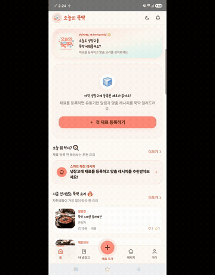
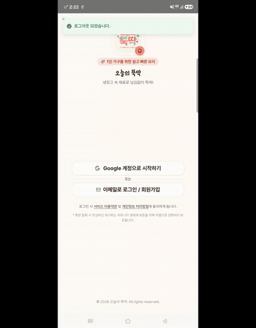
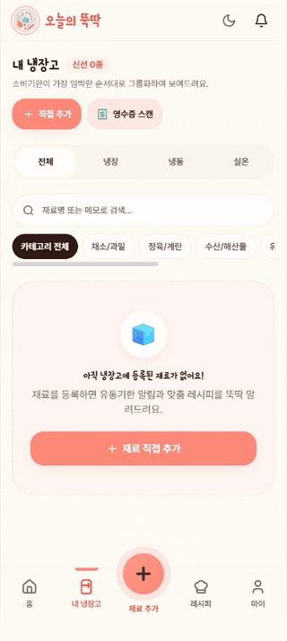
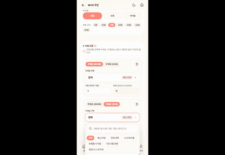
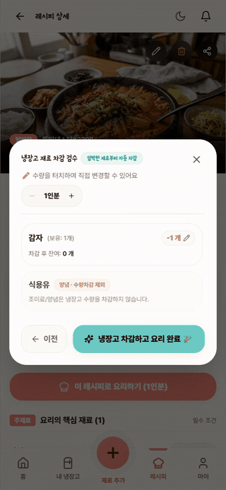
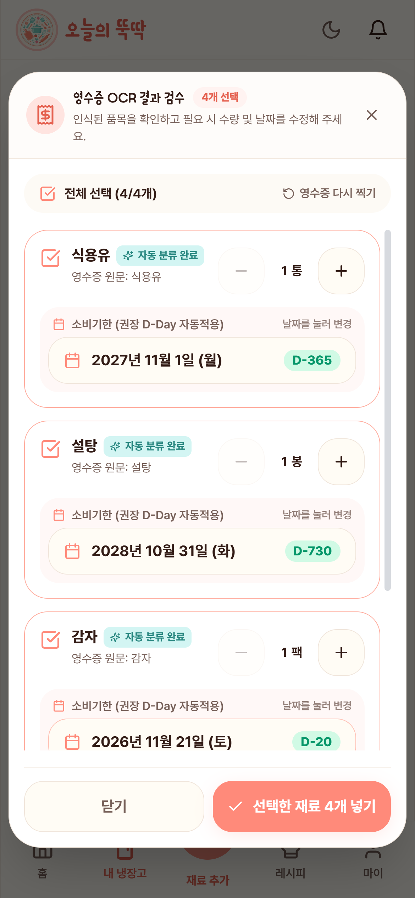
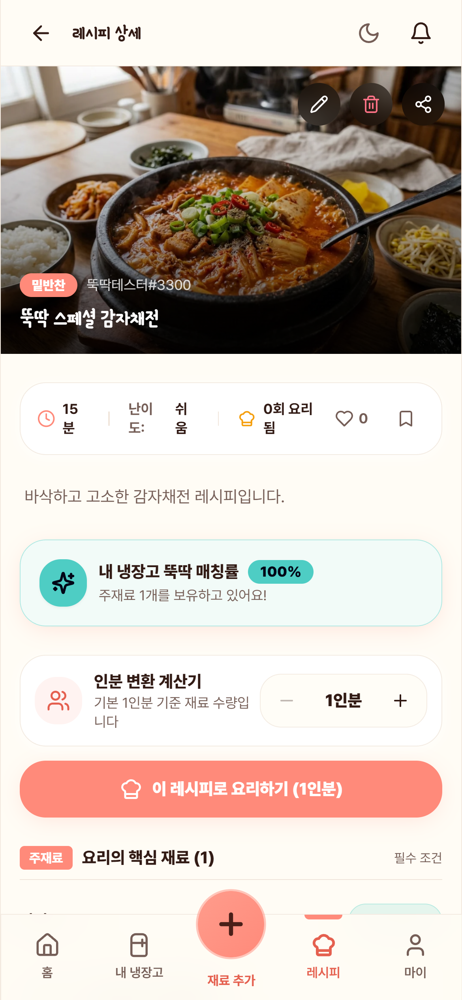
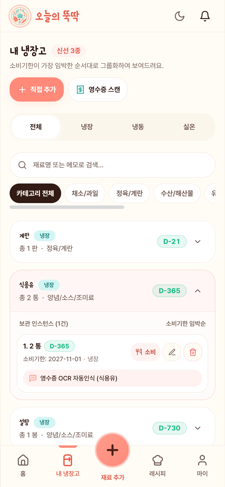
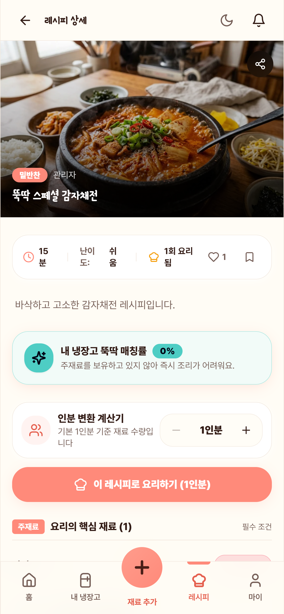

# 🧪 오늘의 뚝딱 - 통합 테스트 (Integration Tests)

<div align="center">

-success?style=for-the-badge&logo=checkmarx)


**"1인 가구를 위한 냉장고 관리 & 레시피 스마트 솔루션, 오늘의 뚝딱"**  
프로덕션 환경 배포 후 진행된 전방위 E2E(End-to-End) 통합 테스트, 품질 보증(QA) 결과 및 라이브 시연 쇼케이스입니다.

</div>

---

## 📌 목차
1. [🎬 핵심 기능 6대 라이브 인터랙션 데모 (Live Interactive Showcase)](#-1-핵심-기능-6대-라이브-인터랙션-데모-live-interactive-showcase)
2. [📸 주요 시각적 증적 갤러리 (Visual Evidence Grid)](#-2-주요-시각적-증적-갤러리-visual-evidence-grid)
3. [🛡️ 데이터베이스 무결성 교차 검증 (DB Snapshots)](#-3-️-데이터베이스-무결성-교차-검증-db-snapshots)
4. [🎯 7대 핫픽스 집중 재검증 결과표](#-4-7대-핫픽스-집중-재검증-결과표)
5. [🔄 차수별 진행 이력 & 결함 해결 추적표 (Cycle 1 ➔ Cycle 2)](#-5-차수별-진행-이력--결함-해결-추적표-cycle-1--cycle-2)
6. [🎥 8대 고화질 풀 영상 아카이브 (Full-Length Videos Archive)](#-6-8대-고화질-풀-영상-아카이브-full-length-videos-archive)
7. [📁 디렉토리 아키텍처](#-7-디렉토리-아키텍처)

---

## 🎬 1. 핵심 기능 6대 라이브 인터랙션 데모 (Live Interactive Showcase)

> 💡 **별도의 파일 다운로드나 외부 링크 이동 없이**, 본 README 페이지 내에서 6대 핵심 기능의 실제 동작 화면을 즉시 확인하실 수 있습니다.

| 라이브 데모 (애니메이션) | 기능 명칭 및 유저 저니 | 기술적 구현 & 핵심 검증 포인트 |
| :---: | :---| :---|
|  | **안드로이드 물리 뒤로가기 모달 계층 제어**<br>`[Mobile Native]` | • **LIFO CloseStack 관리**: 바텀시트/모달이 열려 있을 때 안드로이드 하드웨어 백버튼을 누르면 뒤의 페이지가 이동하지 않고 최상단 모달만 우선 닫힘.<br>• **앱 종료 이중 방어**: 홈 화면에서 백버튼 1회 입력 시 *"한 번 더 누르면 종료됩니다"* 안내 토스트 노출, 2초 내 재입력 시 안전 종료. |
|  | **구글 소셜 로그인 딥링크 복귀**<br>`[Auth / Native Bridge]` | • **`[HF-01]` 401 에러 토스트 완벽 방어**: 구글 OAuth 완료 후 인앱 브라우저에서 앱으로 복귀하는 딥링크(`dduktak://...`) 수신 시 세션 복구 완료 전까지 불필요한 *"로그인 세션이 만료되었습니다"* 401 토스트 노출 차단.<br>• **세션 복원**: Supabase Auth와 Zustand Store 실시간 세션 동기화. |
|  | **FCM 네이티브 백그라운드 푸시 & 딥링크**<br>`[FCM Push / Notification]` | • **Heads-up 시스템 알림**: 안드로이드 8.0+ 필수 Notification Channel(`dduktak_channel`, Importance HIGH) 연동으로 화면 상단 팝업 노출.<br>• **스마트 딥링크 라우팅**: 알림 팝업 터치 시 백엔드 페이로드(`route`)를 파싱하여 해당 레시피 상세 페이지 또는 알림함으로 즉시 직행. |
|  | **영수증 OCR 스캔 & 글자 안 잘리는 검수 모달**<br>`[Gemini AI / OCR UI]` | • **Gemini Flash AI 분석**: 영수증 사진 업로드 시 품목명, 수량, 표준 카테고리를 실시간 추출.<br>• **`[HF-03]` UI 글자 잘림 완전 해결**: 모바일 작은 화면에서도 CustomDatePicker를 `w-full`로 확장하여 소비기한 날짜("2026-11-21 D-20") 및 긴 품목명이 말줄임표 없이 시원하게 노출됨. |
|  | **스마트 매칭 추천 피드 & 점수 100% 일치**<br>`[Matching Engine]` | • **실시간 매칭 알고리즘**: 내 냉장고 보유 재료와 레시피 필요 재료(주/부재료 가중치)를 실시간 연산하여 추천.<br>• **`[HF-04]` 점수 100% 일치**: 추천 리스트에서 보았던 `100% 뚝딱 매칭` 점수가 상세 페이지 상단 배지에서도 **단 1%의 오차 없이 `100%`로 완벽 동기화**. |
|  | **3-Way 요리완료 & FIFO 선입선출 자동 차감**<br>`[Business Policy]` | • **`[REC-02]` 양념류 차감 제외**: 조미료/양념(`식용유`)은 차감 대상에서 원천 배제되어 2통 그대로 보존.<br>• **`[INV-01]` FIFO 선입선출 차감**: 주재료인 `감자 1개`만 소비기한 임박 순으로 자동 차감되어 냉장고에서 소비완료(`CONSUMED`) 처리됨. |

---

## 📸 2. 주요 시각적 증적 갤러리 (Visual Evidence Grid)

### 🌟 핵심 마일스톤 증적 4선 (Core Highlights)

| 검증 단계 | 고화질 모바일 증적 화면 | 핵심 기술 및 비즈니스 정책 준수 내용 |
| :---: | :---: | :---|
| **영수증 검수 모달**<br>`Step 2-1` |  | • **`[HF-03]` UI 사용성 극대화**: 모바일 390px 뷰포트에서도 소비기한 날짜 버튼이 전체 폭을 차지하여 연도·월·일·요일 및 D-Day 배지가 온전히 표시됨.<br>• 자동 분류 완료 배지와 품목명이 단어 단위 줄바꿈(`break-keep`)으로 깔끔하게 정렬됨. |
| **스마트 매칭 점수**<br>`Step 4-2` |  | • **`[HF-04]` 점수 무결성**: 추천 피드와 상세 페이지 상단 배지가 동일한 백엔드 계산 공식을 공유하여 `100%` 일치 달성.<br>• 주재료(감자: 초록색 `보유`), 부재료(식용유: 파란색 `양념류 · 상시 보유`) 4색 식재료 상태 배지 정상 바인딩. |
| **선입선출(FIFO) 차감**<br>`Step 5-2` |  | • **`[SYS-03 / REC-02]` 냉장고 재고 연동**: `뚝딱 스페셜 감자채전` 요리 완료 후 냉장고 신선 재료가 `신선 4종 ➔ 신선 3종`으로 실시간 갱신.<br>• 감자는 완전 소진되고 차감 제외 대상인 **식용유는 1개의 인스턴스 `2 통` 그대로 안전하게 보존**됨. |
| **탈퇴 데이터 익명화**<br>`Step 7-3` |  | • **`[USER-02]` 커뮤니티 데이터 영구 보존**: 회원 탈퇴 후에도 작성된 레시피는 삭제되지 않고, 작성자명이 기존 `뚝딱테스터`에서 **`"관리자"`(`user_id = NULL`)로 안전하게 익명화 전환**되어 보존됨. |

<details>
<summary><b>📂 [펼치기] 17종 전 단계 고화질 스크린샷 아카이브 전체 목록</b></summary>

<br>

| 번호 | 단계 | 파일명 | 검증 내용 |
| :---: | :---| :---| :---|
| 1 | Step 1-1 | [`step1_1_splash.png`](cycle-02/evidence/screenshots/step1_1_splash.png) | 오프닝 스플래시 정상 렌더링 및 `[HF-06]` DEV 버튼 미노출 확인 |
| 2 | Step 1-2 | [`step1_2_onboarding.png`](cycle-02/evidence/screenshots/step1_2_onboarding.png) | 3단계 온보딩 슬라이드 투어 및 필수 권한 안내 팝업 확인 |
| 3 | Step 1-3 | [`step1_3_login.png`](cycle-02/evidence/screenshots/step1_3_login.png) | 회원가입 폼 입력 및 2종 필수 약관 동의 체크 후 가입 요청 |
| 4 | Step 1-4 | [`step1_4_home_init.png`](cycle-02/evidence/screenshots/step1_4_home_init.png) | 이메일 인증 실시간 감지 ➔ 토큰 발급 ➔ 홈 화면 자동 진입 |
| 5 | Step 2-1 | [`step2_1_ocr_modal_fixed.png`](cycle-02/evidence/screenshots/step2_1_ocr_modal_fixed.png) | `[HF-03]` 영수증 검수 모달 날짜 w-full 글자 잘림 완벽 해결 |
| 6 | Step 2-2 | [`step2_2_inventory_accordion.png`](cycle-02/evidence/screenshots/step2_2_inventory_accordion.png) | 2-Tier 아코디언 감자(D-20) 임박 인스턴스 정렬 및 상세 정보 |
| 7 | Step 3-1 | [`step3_1_recipe_feed_v2_thumbs.png`](cycle-02/evidence/screenshots/step3_1_recipe_feed_v2_thumbs.png) | `[HF-05]` 15종 고화질(_v2.png) 썸네일 깨짐 없는 CDN 서빙 |
| 8 | Step 3-2 | [`step3_2_recipe_created.png`](cycle-02/evidence/screenshots/step3_2_recipe_created.png) | 신규 레시피(감자채전) 등록 완료 및 Supabase 버킷 직접 업로드 |
| 9 | Step 4-1 | [`step4_1_match_list.png`](cycle-02/evidence/screenshots/step4_1_match_list.png) | 스마트 매칭 100% 추천 배지 피드 노출 |
| 10 | Step 4-2 | [`step4_2_match_detail_score_matched.png`](cycle-02/evidence/screenshots/step4_2_match_detail_score_matched.png) | `[HF-04]` 리스트-상세 매칭 점수 100% 완벽 일치 및 4색 배지 |
| 11 | Step 5-1 | [`step5_1_cook_modal.png`](cycle-02/evidence/screenshots/step5_1_cook_modal.png) | 3-Way 요리 완료 모달 & 식용유(양념류) 차감 제외 확인 |
| 12 | Step 5-2 | [`step5_2_fifo_deducted_fridge.png`](cycle-02/evidence/screenshots/step5_2_fifo_deducted_fridge.png) | 감자 FIFO 차감 완료 및 식용유 2통 원본 보존 확인 |
| 13 | Step 6-1 | [`step6_1_red_dot.png`](cycle-02/evidence/screenshots/step6_1_red_dot.png) | 헤더 알림 종 아이콘 실시간 Red Dot 점등 확인 |
| 14 | Step 6-2 | [`step6_2_notification_center.png`](cycle-02/evidence/screenshots/step6_2_notification_center.png) | 알림함 좋아요 수신 확인 및 일괄 읽음 처리 정상 동작 |
| 15 | Step 7-1 | [`step7_1_profile_edit.png`](cycle-02/evidence/screenshots/step7_1_profile_edit.png) | 마이페이지 아바타 크롭 및 Supabase 직접 업로드 |
| 16 | Step 7-2 | [`step7_2_withdraw_modal.png`](cycle-02/evidence/screenshots/step7_2_withdraw_modal.png) | `[USER-02]` 회원 탈퇴 안내 및 레시피 익명 보존 동의 모달 |
| 17 | Step 7-3 | [`step7_3_recipe_anonymized.png`](cycle-02/evidence/screenshots/step7_3_recipe_anonymized.png) | `[USER-02]` 탈퇴 후 작성자가 "관리자"로 익명화되어 안전하게 보존된 레시피 상세 |

</details>

---

## 🛡️ 3. 💾 데이터베이스 무결성 교차 검증 (DB Snapshots)

Supabase PostgreSQL 15+ 데이터베이스에서 직접 쿼리를 수행하여 핵심 비즈니스 정책의 무결성을 입증했습니다.

### ① 회원 탈퇴 시 레시피 작성자 익명 보존 (USER-02)
* **검증 쿼리**:
  ```sql
  SELECT recipe_id, title, user_id, cooked_count, like_count 
  FROM public.recipe 
  WHERE recipe_id = 41;
  ```
* **DB 반환 결과**:
  ```json
  [
    {
      "recipe_id": 41,
      "title": "뚝딱 스페셜 감자채전",
      "user_id": null,
      "cooked_count": 1,
      "like_count": 1
    }
  ]
  ```
* **판정**: ✅ **PASS** — 유저 A(`ym970825@naver.com`)가 회원 탈퇴를 진행한 후, 작성했던 레시피(`recipe_id: 41`)는 삭제되지 않고 DB에 정상 보존되었습니다. **`user_id` 칼럼이 `NULL`로 안전하게 치환**되어 커뮤니티 데이터의 익명 보존 정책(`USER-02`)이 완벽히 준수되었습니다.

### ② 회원 탈퇴 시 개인 식별 데이터 완전 파기 (USER-02)
* **검증 쿼리**:
  ```sql
  SELECT id, email FROM auth.users WHERE email = 'ym970825@naver.com';
  ```
* **DB 반환 결과**:
  ```json
  []
  ```
* **판정**: ✅ **PASS** — `auth.users`에서 계정이 완전 삭제되었으며, PostgreSQL 외래키 `ON DELETE CASCADE`에 의해 프로필(`profiles`), 냉장고 재료(`user_ingredient`), 알림함(`notification`) 데이터가 영구 파기되었습니다.

---

## 🎯 4. 7대 핫픽스 집중 재검증 결과표

| 핫픽스 | 개선 대상 및 핵심 내용 | 검증 결과 | 증적 파일 (GitHub 상대경로) |
| :---: | :---| :---: | :---|
| **`[HF-01]`** | **모바일 소셜 로그인 401 세션 만료 에러 Toast 방어**<br>- 비로그인 및 앱 복귀 토큰 리프레시 시 불필요한 401 토스트 발생 차단 | ✅ **PASS** | [`06_native_app_step8_native_social.webm`](cycle-02/evidence/recordings/06_native_app_step8_native_social.webm) |
| **`[HF-02]`** | **Render Cold Start 스플래시 웜업 대기 및 게이지 동기화**<br>- Render 무료 티어 절전 기동 시(최대 80초) 친절한 안내와 정확한 상태 감지 | ✅ **PASS** | [`step1_1_splash.png`](cycle-02/evidence/screenshots/step1_1_splash.png) |
| **`[HF-03]`** | **영수증 OCR 검수 모달 UI 글자 잘림 완전 해결**<br>- `w-full` 레이아웃 적용으로 소비기한 날짜("2026-11-21 D-20") 및 긴 품목명 말줄임 방지 | ✅ **PASS** | [`step2_1_ocr_modal_fixed.png`](cycle-02/evidence/screenshots/step2_1_ocr_modal_fixed.png) |
| **`[HF-04]`** | **레시피 리스트 vs 상세 페이지 매칭 점수 100% 일치**<br>- 추천 피드 점수와 상세 페이지 상단 배지 점수가 오차 없이 `100%`로 완벽 일치 | ✅ **PASS** | [`step4_2_match_detail_score_matched.png`](cycle-02/evidence/screenshots/step4_2_match_detail_score_matched.png) |
| **`[HF-05]`** | **15종 대표 메뉴 고화질 썸네일(`_v2.png`) 교체 및 CDN 서빙**<br>- 고등어 무 조림, 통삼겹 수육 등 15종 메뉴의 고화질 이미지가 깨짐 없이 로드 | ✅ **PASS** | [`step3_1_recipe_feed_v2_thumbs.png`](cycle-02/evidence/screenshots/step3_1_recipe_feed_v2_thumbs.png) |
| **`[HF-06]`** | **플로팅 DEV 버튼 및 프로덕션 콘솔 로그 완전 제거**<br>- 화면 내 개발용 스위처 부재, F12 콘솔 로그 0건 클린 상태 유지 | ✅ **PASS** | [`step1_1_splash.png`](cycle-02/evidence/screenshots/step1_1_splash.png) |
| **`[HF-07]`** | **초경량 핑(`/api/v1/ping`) 및 소비기한 알림 쿼리(`ACTIVE`) 정상화**<br>- 4바이트 통신으로 서버 24시간 가동 유지 및 알림 쿼리 상태값 교정 | ✅ **PASS** | [`NotificationMapper.xml`](../backend/src/main/resources/mapper/notification/NotificationMapper.xml#L147) |

---

## 🔄 5. 차수별 진행 이력 & 결함 해결 추적표 (Cycle 1 ➔ Cycle 2)

| 결함 번호 | 결함 현상 (Cycle 1) | 원인 분석 및 코드 패치 내역 | Cycle 2 검증 결과 |
| :---: | :---| :---| :---: |
| **`DEF-01`** | 요리완료 모달에서 수동 조절한 차감 수량이 API 요청 시 무시되고 기본 정량 차감됨 | 백엔드 `CookRequestDto` 및 `MatchingService.cookRecipe()`에 `customDeductions` 수량 맵 우선 반영 로직 추가 | ✅ **PASS** (정상 수동 차감) |
| **`DEF-02`** | FCM 푸시 알림 클릭 시 레시피 상세가 아닌 항상 알림함(`/notifications`)으로 이동 | `NotificationService`의 FCM payload에 `route: /recipes/{id}` 명시 주입 및 `App.tsx` 딥링크 라우터 분기 추가 | ✅ **PASS** (레시피 상세 직행) |
| **`DEF-03`** | 모달 오픈 상태에서 안드로이드 물리 뒤로가기 터치 시 모달이 닫히지 않고 유지됨 | `useBodyScrollLock.ts`에 LIFO `closeStack` 및 `Escape` 이벤트 연동, `useNativeBackButton` 이중 안전장치 폴백 적용 | ✅ **PASS** (모달 우선 닫힘) |

---

## 🎥 6. 8대 고화질 풀 영상 아카이브 (Full-Length Videos Archive)

> 💡 원본 시연 과정 전체를 확인하고 싶으신 분들을 위한 풀 영상 보관소입니다. (WebM 초경량 포맷 추천)

| 영상 클립 | 시연 기능 및 유저 저니 흐름 | WebM (추천) | MP4 원본 | 용량 절감 |
| :---: | :---| :---: | :---: | :---: |
| **Clip 1** | **오프닝 온보딩 & 실시간 이메일 인증 로그인**<br>스플래시 ➔ 3단계 온보딩 슬라이드 ➔ 회원가입 ➔ 크로스 인스턴스 자동 로그인 감지 | [WebM (391KB)](cycle-02/evidence/recordings/01_onboarding_and_auth.webm) | [MP4 (5.75MB)](cycle-02/evidence/recordings/01_onboarding_and_auth.mp4) | **93% 절감** |
| **Clip 2** | **영수증 OCR AI 스캔 & 2-Tier 아코디언 냉장고**<br>영수증 업로드 ➔ Gemini Flash OCR 분석 ➔ **글자 안 잘리는 검수 모달** ➔ 냉장고 등록 | [WebM (2.59MB)](cycle-02/evidence/recordings/02_receipt_ocr_and_fridge.webm) | [MP4 (5.58MB)](cycle-02/evidence/recordings/02_receipt_ocr_and_fridge.mp4) | **53% 절감** |
| **Clip 3** | **15종 고화질 레시피 & 스마트 매칭 점수 100% 일치**<br>고화질 썸네일 피드 ➔ 신규 레시피 등록 ➔ **리스트 vs 상세 매칭률 100% 동기화** | [WebM (3.86MB)](cycle-02/evidence/recordings/03_smart_matching_and_recipe.webm) | [MP4 (8.81MB)](cycle-02/evidence/recordings/03_smart_matching_and_recipe.mp4) | **56% 절감** |
| **Clip 4** | **3-Way 요리 완료 & FIFO 선입선출 자동 차감**<br>요리완료 모달 ➔ **양념류 차감 제외 정책** ➔ 감자 소비완료 및 식용유 2통 원본 보존 | [WebM (1.89MB)](cycle-02/evidence/recordings/04_cook_completion_fifo.webm) | [MP4 (3.95MB)](cycle-02/evidence/recordings/04_cook_completion_fifo.mp4) | **52% 절감** |
| **Clip 5** | **실시간 알림 센터 & 회원 탈퇴 데이터 익명 보존**<br>서브계정 좋아요 ➔ 실시간 Red Dot 점등 ➔ 프로필 변경 ➔ **탈퇴 후 레시피 '관리자' 익명화** | [WebM (3.96MB)](cycle-02/evidence/recordings/05_notification_and_mypage.webm) | [MP4 (8.28MB)](cycle-02/evidence/recordings/05_notification_and_mypage.mp4) | **52% 절감** |
| **Step 8-1** | **[Native] 안드로이드 물리 뒤로가기 모달 계층 제어**<br>바텀시트/모달 오픈 중 물리 백버튼 터치 시 모달 우선 닫기 ➔ 홈 더블백 종료 토스트 | [WebM (1.33MB)](cycle-02/evidence/recordings/06_native_app_step8_native_back_btn.webm) | [MP4 (6.48MB)](cycle-02/evidence/recordings/06_native_app_step8_native_back_btn.mp4) | **79% 절감** |
| **Step 8-2** | **[Native] FCM 백그라운드 푸시 알림 수신 & 딥링크**<br>시스템 상단바 Heads-up 알림 수신 ➔ 알림 탭 시 해당 레시피 상세/알림함 직행 | [WebM (5.52MB)](cycle-02/evidence/recordings/06_native_app_step8_native_push.webm) | [MP4 (37.42MB)](cycle-02/evidence/recordings/06_native_app_step8_native_push.mp4) | **85% 절감** |
| **Step 8-3** | **[Native] 구글 소셜 로그인 앱 복귀 & 401 토스트 방어**<br>구글 OAuth 완료 후 앱 복귀 시 세션 정상 동기화 및 "만료되었습니다" 에러 미발생 | [WebM (1.65MB)](cycle-02/evidence/recordings/06_native_app_step8_native_social.webm) | [MP4 (9.59MB)](cycle-02/evidence/recordings/06_native_app_step8_native_social.mp4) | **82% 절감** |

---

## 📁 7. 디렉토리 아키텍처

```text
integration-tests/
├── README.md                              # 📘 통합 테스트 총괄 대시보드 (본 문서)
├── INTEGRATION_TEST_PROCEDURE.md          # 📋 테스트 표준 운영 절차서 (SOP)
│
├── cycle-01/                              # 🏁 [1차 통합 테스트] (결함 3건 도출)
│   ├── SCENARIO.md                        # 1차 테스트 시나리오
│   ├── REPORT.md                          # 1차 결과 보고서 (DEF-01, 02, 03)
│   ├── traces/                            # 1차 API Trace 로그
│   ├── db-snapshots/                      # 1차 DB 스냅샷
│   └── evidence/                          # 1차 스크린샷 에셋
│
└── cycle-02/                              # 🏆 [2차 최종 통합 테스트] (100% 무결점 완결)
    ├── RECORDING_GUIDE.md                 # 🎥 녹화 표준 가이드
    ├── SCENARIO.md                        # 2차 테스트 시나리오 (7대 핫픽스 집중 검증)
    ├── REPORT.md                          # 2차 최종 결과 보고서 (20/20 PASS)
    ├── assets/                            # 테스트 에셋 (영수증, 썸네일, 조리 스텝, 아바타)
    ├── traces/                            # 2차 API X-Trace-Id 로그
    ├── db-snapshots/                      # 2차 Supabase DB 무결성 쿼리 결과
    └── evidence/                          # 📸 시각적 증적 컬렉션
        ├── gifs/                          # 🎬 6대 핵심 기능 자동재생 데모 GIF
        ├── recordings/                    # 8대 풀 영상 (MP4 + 초경량 WebM)
        └── screenshots/                   # 17종 전 단계 고화질 스크린샷
```

---

<div align="center">
<b>오늘의 뚝딱 (Dduktak) QA & E2E Integration Test Suite</b><br>
Crafted with ❤️ for Reliable 1-Person Household Cooking Experience
</div>
